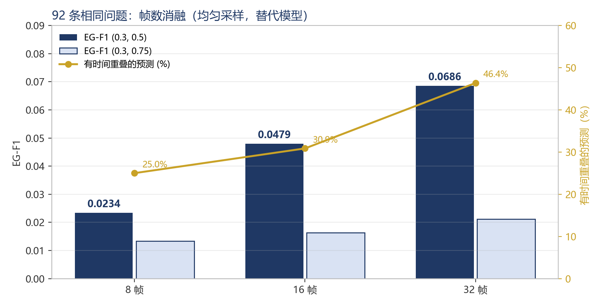
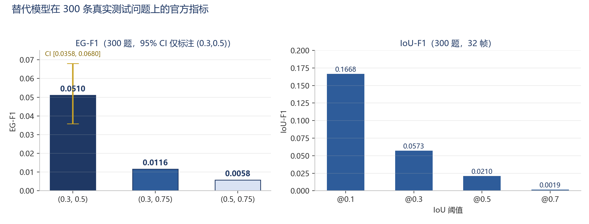
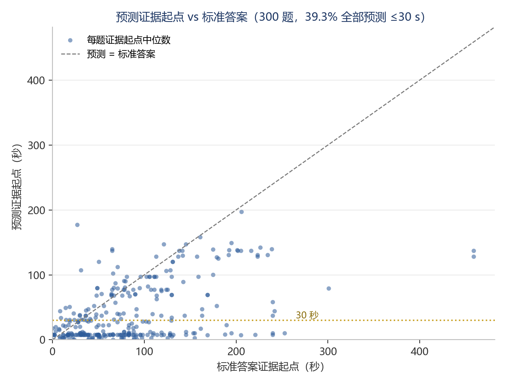

# EG-VQA Reproduction: Benchmark Auditing, Metric Validation, and Temporal Evidence Localization Analysis

This repository is an independent reproduction and experimental analysis of
**EG-VQA: Benchmarking Verifiable Video Question Answering with Grounded Temporal Evidence**.
It focuses on verifying the official data and evaluation pipeline, then studying temporal evidence
localization with a clearly labelled substitute baseline on consumer hardware.

> **Scope statement.** This is not the official implementation and not a reproduction of the paper's
> EG-Reasoner model. The official model was not trained, and the official checkpoint was not used.
> All model scores in this repository belong to a Qwen2.5-VL-3B-Instruct substitute baseline and
> must not be read as EG-Reasoner or paper results.

## 1. Project Overview

Traditional video question answering evaluates answers only. EG-VQA additionally requires a model to
localize the temporal evidence that supports its answer: a time span plus a textual description.
The benchmark introduces **EG-F1**, which requires both temporal IoU and description similarity to
pass thresholds before a prediction counts as a match.

This project asks three engineering questions:

1. Can the official annotations, preprocessing, and EG-F1 implementation be validated end to end on a
   local machine?
2. What can be measured with a small, quantized video-language model when the official 7B model is
   out of reach?
3. Where does evidence localization fail, and is the bottleneck temporal, semantic, or output-format related?

## 2. Original Paper and Resources

- **Paper**: [EG-VQA: Benchmarking Verifiable Video Question Answering with Grounded Temporal Evidence](https://arxiv.org/abs/2606.24797)
- **Official code**: [HCPLab-SYSU/EG-VQA](https://github.com/HCPLab-SYSU/EG-VQA)
- **Dataset**: [lphuang33/EG-VQA](https://huggingface.co/datasets/lphuang33/EG-VQA) (CC-BY-4.0)
- **Project page**: [hcplab-sysu.github.io/EG-VQA](https://hcplab-sysu.github.io/EG-VQA/)

The official repository is **not vendored here** (its license is Apache-2.0, declared under
`EG-Reasoner/LICENSE`; the repository root has no separate LICENSE file). Clone it into
`./official_repo` to run the scripts that build on it:

```bash
git clone https://github.com/HCPLab-SYSU/EG-VQA.git official_repo
git -C official_repo checkout 0ca6b53c8d3aa998eaf24f903b0f6cb6b8ab88f5
```

This reproduction was developed against commit `0ca6b53c8d3aa998eaf24f903b0f6cb6b8ab88f5`.

## 3. My Contributions

- **Dataset integrity and annotation auditing**: byte-level comparison with the official Hugging Face
  files, scale checks, split-leakage checks, evidence-span validation, and annotation-defect discovery.
- **EG-F1 metric validation**: unit tests for parsing, IoU, Hungarian matching and F1 aggregation, plus
  an oracle end-to-end check through the official evaluation script.
- **Pipeline auditing**: found and corrected a frame-selection bias in local inference (first *N* frames
  instead of uniform sampling across the video).
- **Alternative baseline inference**: Qwen2.5-VL-3B-Instruct with 4-bit NF4 quantization, driven through
  the official prompt and response schema.
- **Controlled ablations**: 8/16/32-frame sampling and a timestamp-prompt variant on the same 92 questions.
- **Stratified expansion**: 300 real test questions from 60 videos, 75 per question type, fixed seed.
- **Diagnostics**: temporal start/end errors, no-overlap rate, early-timestamp bias, output-completeness and
  `max_new_tokens` paired validation.
- **Documentation and reporting**: experiment log, metric review, training feasibility review, final report.

**AI assistance disclosure.** The project was planned, configured, reviewed and analysed by the author.
Code implementation and experiment execution were assisted by Claude Code (an AI coding tool); the author
reviewed the configurations, inspected the outputs, verified the reported numbers against saved artefacts,
and is responsible for the conclusions. The repository does not claim that all code was written independently.

## 4. Repository Structure

```text
EG-VQA-Reproduction/
├── README.md
├── LICENSE                     # MIT for this repository's original code and text
├── NOTICE.md                   # third-party components, licenses, attribution
├── requirements.txt            # analysis / preprocessing dependencies
├── requirements-inference.txt  # optional model-inference dependencies
├── .gitignore
├── configs/                    # ablation configurations (5 JSON files)
├── scripts/                    # experimental and analysis scripts (23 files)
├── tests/                      # pytest suite (self-contained + official-repo-dependent)
├── docs/                       # reports: plan, metric review, ablation, final report, logs
└── results/
    ├── summaries/              # audit, ablation, bootstrap, truncation, diagnostics, environment
    ├── predictions/            # raw model outputs for the reported runs (7 runs + meta)
    ├── metrics/                # official evidence-metric outputs for those runs
    ├── figures/                # figures rendered from the saved result files
    └── subsets/                # fixed 92-question and stratified 300-question id lists
```

The official code, dataset annotations, videos, extracted frames, and model weights are **not** included.
The repository contains only this project's scripts, reports, and the experimental outputs needed to
verify the reported numbers.

## 5. Experimental Results

All numbers below are read from files under `results/`; the mapping from each number to its source file
is in [`docs/RESULTS_PROVENANCE.md`](docs/RESULTS_PROVENANCE.md). No value is reconstructed from memory.

### 5.1 Dataset audit

| Item | Train | Test | Total / paper |
|---|---:|---:|---|
| Videos | 1,731 | 336 | 2,067 |
| Questions | 8,949 | 2,889 | 11,838 |
| Evidence spans | 20,009 | 6,839 | 26,848 |
| descriptive / temporal / causal / counterfactual | 2,196 / 2,212 / 1,994 / 2,547 | 657 / 751 / 748 / 733 | — |

- The official `train.json` and `test.json` (inside `official_repo/`) were checked locally against the
  Hugging Face release with SHA-256 and are byte-identical. This public repository does not include the
  annotation files.
- Train/test video-ID intersection is **zero**.
- Annotation defects: **14 zero-length evidence spans** (12 train, 2 test) and **7 spans ending beyond
  the video duration** (train), **21 defects in total**. These are reported, not silently repaired.

### 5.2 EG-F1 validation

- The hard EG-F1 implementation matches the paper's Appendix B formulation (thresholded edges,
  `IoU × Sim` weights, Hungarian matching, P/R/F1).
- Oracle check (predictions copied from ground truth, official script, real BGE-M3):
  2,889 questions give **EG-F1 = 0.999654** at all three threshold pairs. The small gap is exactly
  caused by the two zero-length ground-truth spans, so the official metric's ceiling is below 1.0.

### 5.3 Frame-sampling ablation: official evidence metrics (same 92 real test questions)

A: legacy first-8-of-32 frames; A2/B/C/D: uniform sampling across the video.

| Config | Frames | Sampling | Prompt | EG-F1 (0.3, 0.5) | EG-F1 (0.3, 0.75) | IoU-F1 @0.1 |
|---|---:|---|---|---:|---:|---:|
| A (legacy) | 8 | first 8 | official | 0.0455 | 0.0127 | 0.1045 |
| A2 | 8 | uniform | official | 0.0234 | 0.0133 | 0.0546 |
| B | 16 | uniform | official | 0.0479 | 0.0163 | 0.1152 |
| **C** | **32** | uniform | official | **0.0686** | **0.0212** | **0.1578** |
| D | 8 | uniform | + timestamp instruction | 0.0280 | 0.0093 | 0.0566 |

Paired comparison against A2 on the same questions: C improves EG-F1 by **+0.0452**
(11 improved / 4 worsened, Wilcoxon p = 0.0399); B +0.0245 (p = 0.0701); D +0.0046 (p = 0.2500).
These are exploratory tests on 92 questions and are not corrected for multiple comparisons.

**Custom diagnostics (not official paper metrics)** — computed by this project on the same 92 questions to analyse temporal localization:

| Config | Predictions within first 30 s | No temporal overlap | Mean best IoU |
|---|---:|---:|---:|
| A (legacy) | 55.1% | 73.6% | 0.056 |
| A2 | 66.7% | 75.0% | 0.046 |
| B | 47.3% | 69.1% | 0.065 |
| C | 31.5% | 53.6% | 0.084 |
| D | 73.9% | 79.3% | 0.045 |

*No temporal overlap* means a predicted span has zero IoU with every ground-truth span of that question.
*Mean best IoU* averages, over predictions, the best IoU against the question's ground-truth spans.



**Why A differs from A2.** The legacy local inference called `frame_paths_for_video(...)[:max_frames]`,
so 8 frames covered only the first **22.6%** of each video (verified on 10 videos: 22.5%–22.7%).
The official preprocessing itself samples 32 frames uniformly and is correct. A2 fixes the selection,
making 8/16/32 a fair frame-count comparison.

### 5.4 Stratified 300-question evaluation

60 real test videos, 526 available questions, 75 sampled per question type, seed `20261030`
(ActivityNet 187 / YouCook2 59 / HiREST 54). Configuration C (32 frames, uniform, official prompt).

| Metric | Value | 95% CI |
|---|---:|---|
| EG-F1 (0.3, 0.5) | **0.0510** | [0.0358, 0.0680] |
| EG-F1 (0.3, 0.75) | 0.0116 | — |
| EG-F1 (0.5, 0.75) | 0.0058 | — |
| IoU-F1 @0.1 / @0.3 / @0.5 / @0.7 | 0.1668 / 0.0573 / 0.0210 / 0.0019 | — |

The 92-question C estimate (0.0686) is optimistic; the 300-question estimate is more reliable.



### 5.5 Temporal localization diagnostics (custom metrics, not paper metrics)

On the same 300 questions:

| Diagnostic | Value |
|---|---:|
| Predictions with no temporal overlap with any ground-truth span | 55.4% (501 / 905) |
| Questions whose predictions all start within 30 s | 39.3% |
| Mean best IoU per prediction | 0.081 |
| Predicted start median vs ground-truth start median | 16.0 s vs 73.0 s |
| Invalid timestamps / spans beyond duration / empty evidence | 1 / 39 / 0 |
| Complete think+answer outputs | 178 / 300 |
| Mean inference time / peak VRAM | 16.87 s / 3.96 GiB |

A controlled perturbation further separates the two metric dimensions: keeping timestamps exact but
replacing descriptions with unrelated ones leaves IoU-F1 at 0.9967 while EG-F1 (0.3, 0.75) falls to 0.3451.
The model's dominant failure is temporal, not semantic.



### 5.6 Output completeness and `max_new_tokens`

On the same 92 questions and 32-frame setting, raising `max_new_tokens` from 256 to 512:

| Metric | 256 | 512 |
|---|---:|---:|
| EG-F1 (0.3, 0.5) | 0.0686 | 0.0669 |
| Outputs with all closing tags | 35 / 92 | 36 / 92 |
| Outputs ending inside `<think>` | 41 | 41 |
| Outputs hitting the token cap | 7 | 6 |
| Mean inference time | 19.46 s | 20.61 s |

Paired per-question change: 0 improved, 1 worsened, 91 unchanged; the 35 outputs that were already
complete are byte-identical. **The token budget is not the main cause of incomplete outputs**; early EOS
and repetitive generation dominate. The 41 outputs that stop inside `<think>` average **45.9 tokens**
(median 33), far below the 256 cap; the 105.4 figure is the mean over all 92 outputs, not over those 41
(token counts: complete 35 → 134.2; answer-truncated 10 → 158.1; think-truncated 41 → 45.9;
evidence-truncated 6 → 256.0).

## 6. Reproduction Limitations

- The official **EG-Reasoner was not trained**. The paper's configuration (Qwen2.5-VL-7B, 4 GPUs,
  FSDP, vLLM rollout) does not fit an 8 GB laptop GPU.
- The official **checkpoint was not obtained** (no public weights were found at the time of the work),
  so the paper's table values were **not reproduced**.
- All model runs use **Qwen2.5-VL-3B-Instruct**, **4-bit NF4**, greedy decoding, and 8/16/32 frames.
  It is a substitute baseline, not the paper model.
- **Answer-side metrics** (relaxed/strict accuracy) were not computed: they require an OpenAI-compatible
  judge API key, and the official script refuses to run without one.
- Only 60 test videos were downloaded; the full 2,889-question test set was not run.
  The 300-question estimate is reported with its uncertainty instead.
- Per-type rankings are unstable between the 92- and 300-question sets, so no claim is made about which
  question type is intrinsically easier.

## 7. Environment

| Item | Value |
|---|---|
| OS | Windows 11 (10.0.26200) |
| GPU | NVIDIA RTX 4060 Laptop, 8 GB VRAM, driver 560.94 |
| Analysis environment | Python 3.13.5 (numpy 2.1.3, scipy 1.15.3, pyarrow 19.0.0, opencv 5.0.0, pytest 8.3.4) |
| Inference environment | Python 3.10.6, torch 2.4.1+cu124, transformers 4.51.3, bitsandbytes 0.50.2 |
| Semantic model | BGE-M3 (2.27 GB), evaluated on CPU |
| Model | Qwen/Qwen2.5-VL-3B-Instruct, 7.1 GB weights, NF4 4-bit |

Detailed records: [`docs/ENVIRONMENT.md`](docs/ENVIRONMENT.md) and
`results/summaries/env_report_*.json`.

## 8. How to Run

The official code is required for preprocessing and metric computation. It is not shipped here.

```bash
# 1. Environment
python -m venv .venv
# Windows: .venv/Scripts/python ...    Linux/macOS: .venv/bin/python ...
.venv/Scripts/python -m pip install -r requirements.txt
# optional inference environment (see requirements-inference.txt); install a torch
# build matching your driver, e.g.
#   pip install torch==2.4.1 torchvision==0.19.1 --index-url https://download.pytorch.org/whl/cu124
# Download Qwen/Qwen2.5-VL-3B-Instruct into models/Qwen2.5-VL-3B-Instruct with your
# preferred Hugging Face client. BGE-M3 is downloaded by the official metric script.

# 2. Official repository and annotations
git clone https://github.com/HCPLab-SYSU/EG-VQA.git official_repo
git -C official_repo checkout 0ca6b53c8d3aa998eaf24f903b0f6cb6b8ab88f5

# 3. Dataset audit
python scripts/audit_data.py --data-root official_repo/data
python scripts/analyze_annotations.py --data-root official_repo/data

# 4. Optional: fetch a few real videos from the 13 GB videos.tar using HTTP ranges
python scripts/fetch_videos_from_tar.py --scan --from-json official_repo/data/test.json   --per-split 10 --max-members 300 --out-dir official_repo/data/videos

# 5. Video-level subset (only videos that exist locally) and frame extraction
python scripts/build_video_subset.py --annotations official_repo/data/test.json   --videos-dir official_repo/data/videos --output experiments/subsets/test_subset.json
python scripts/extract_frames.py --dataset experiments/subsets/test_subset.json   --video-root official_repo/data --output-root official_repo/data/frames/test
python scripts/verify_frames.py --split test

# 6. Build the fixed 92-question inference annotations from the official annotations.
#    The converter prints the number of selected videos/questions; the reported run is
#    10 videos / 92 questions. The fetch command above retrieves the first 10 test videos
#    in tar order, which is how this fixed set was formed.
python scripts/build_inference_annotations.py --annotations official_repo/data/test.json   --question-ids results/subsets/fixed92_question_ids.json   --output experiments/ablation/fixed92_annotations.json

# 7. Oracle metric validation (no model needed)
python scripts/make_oracle_predictions.py --annotations official_repo/data/test.json   --output experiments/oracle/test_oracle_50.json --limit 50
HF_HUB_OFFLINE=1 .venv/Scripts/python official_repo/evaluation/evidence_metrics.py   --input experiments/oracle/test_oracle_50.json --semantic-device cpu

# 8. Substitute-baseline inference on the 92 questions
HF_HUB_OFFLINE=1 .venv/Scripts/python scripts/infer_qwen_vl.py   --model-path models/Qwen2.5-VL-3B-Instruct   --annotations experiments/ablation/fixed92_annotations.json --only-available   --max-frames 32 --frame-selection uniform --load-in-4bit   --output experiments/ablation/predictions/C_uniform_32.json --overwrite

# 9. Official evidence metrics on the predictions
mkdir -p experiments/ablation/metrics experiments/ablation/diagnostics
HF_HUB_OFFLINE=1 .venv/Scripts/python official_repo/evaluation/evidence_metrics.py   --input experiments/ablation/predictions/C_uniform_32.json   --output experiments/ablation/metrics/C_uniform_32_evidence_metrics.json --semantic-device cpu

# 10. Diagnostics and aggregation
python scripts/diagnose_predictions.py   --predictions experiments/ablation/predictions/C_uniform_32.json   --metrics experiments/ablation/metrics/C_uniform_32_evidence_metrics.json   --meta experiments/ablation/predictions/C_uniform_32.meta.json --label C_uniform_32   --output experiments/ablation/diagnostics/C_uniform_32.json
python scripts/analyze_temporal_bias.py   --predictions experiments/ablation/predictions/C_uniform_32.json   --output experiments/ablation/diagnostics/temporal_bias_C32.json
python scripts/summarize_ablation.py   --metrics-dir experiments/ablation/metrics   --diagnostics-dir experiments/ablation/diagnostics   --configs-dir configs --meta-dir experiments/ablation/predictions   --output-dir experiments/ablation/summary

# 11. 300-question stratified evaluation (same frames; only questions with frames are eligible)
python scripts/build_expanded_set.py --annotations official_repo/data/test.json   --frames-root official_repo/data/frames/test --total 300 --seed 20261030   --output experiments/ablation/expanded_questions.json
python scripts/build_inference_annotations.py --annotations official_repo/data/test.json   --question-ids experiments/ablation/expanded_questions.json   --output experiments/ablation/expanded_annotations.json
HF_HUB_OFFLINE=1 .venv/Scripts/python scripts/infer_qwen_vl.py   --model-path models/Qwen2.5-VL-3B-Instruct   --annotations experiments/ablation/expanded_annotations.json --only-available   --max-frames 32 --frame-selection uniform --load-in-4bit   --output experiments/ablation/predictions/expanded_C32.json --overwrite
HF_HUB_OFFLINE=1 .venv/Scripts/python official_repo/evaluation/evidence_metrics.py   --input experiments/ablation/predictions/expanded_C32.json   --output experiments/ablation/metrics/expanded_C32_evidence_metrics.json --semantic-device cpu
python scripts/diagnose_predictions.py   --predictions experiments/ablation/predictions/expanded_C32.json   --metrics experiments/ablation/metrics/expanded_C32_evidence_metrics.json   --meta experiments/ablation/predictions/expanded_C32.meta.json --label expanded_C32   --output experiments/ablation/diagnostics/expanded_C32.json

# 12. Tests
python -m pytest tests -q
```

Notes:

- `scripts/extract_frames.py` imports the official module and injects a Windows font path; the official
  repository is left untouched.
- `scripts/infer_qwen_vl.py` supports `--frame-selection {first,uniform}` and
  `--prompt-variant {official,timestamp}`. Use `uniform` for the reported experiments; `first` only
  reproduces the legacy bias.
- The official preprocessing and metric scripts expect `official_repo/data/...`. The shipped
  `results/` tree is a curated copy; scripts write to an `experiments/` workspace by default.
- The reported videos, frames, and model weights are not included; download them from the official
  dataset and the model hub. `HF_ENDPOINT=https://hf-mirror.com` was used here when huggingface.co was
  unreachable.

### Test status

- Fresh clone without the official repository: **31 passed, 9 skipped** (official-repo-dependent tests skip).
- With `./official_repo` cloned and analysis dependencies installed: **119 passed, 2 skipped**.
  The two skips are BGE-M3 integration tests; they run once the BGE-M3 weights are present.

## 9. Data and Licenses

- **Dataset**: EG-VQA, CC-BY-4.0. Shipped prediction files include question/answer/evidence fields from
  the test annotations as ground truth, with attribution. See [`NOTICE.md`](NOTICE.md).
- **Official code**: Apache-2.0, not redistributed; clone from the official repository.
- **This repository's original code and text**: MIT (see [`LICENSE`](LICENSE)).
- **Model outputs**: generated with Qwen2.5-VL-3B-Instruct (Apache-2.0). Semantic similarity uses BGE-M3 (MIT).

## 10. Citation

```bibtex
@article{huang2026egvqa,
  title={EG-VQA: Benchmarking Verifiable Video Question Answering with Grounded Temporal Evidence},
  author={Huang, Linpeng and Chen, Weixing and Chen, Zexin and Liu, Yang and Lin, Liang},
  journal={arXiv preprint arXiv:2606.24797},
  year={2026}
}
```

## 11. Documentation Map

| Document | Content |
|---|---|
| [`docs/FINAL_REPRODUCTION_REPORT.md`](docs/FINAL_REPRODUCTION_REPORT.md) | Full 12-section reproduction report |
| [`docs/METRIC_REVIEW.md`](docs/METRIC_REVIEW.md) | Paper formula vs official implementation |
| [`docs/ABLATION_REPORT.md`](docs/ABLATION_REPORT.md) | Controlled ablation report |
| [`docs/RESULTS_ANALYSIS.md`](docs/RESULTS_ANALYSIS.md) | Earlier baseline analysis and sensitivity study |
| [`docs/ENVIRONMENT.md`](docs/ENVIRONMENT.md) | Hardware, software, and dependency notes |
| [`docs/TRAINING_REVIEW.md`](docs/TRAINING_REVIEW.md) | Why official training is infeasible on 8 GB |
| [`docs/EXPERIMENT_LOG.md`](docs/EXPERIMENT_LOG.md) | Chronological run log with failures kept |
| [`docs/REPRODUCTION_PLAN.md`](docs/REPRODUCTION_PLAN.md) | Scope and feasibility plan |
| [`docs/REPRODUCTION_SUMMARY.md`](docs/REPRODUCTION_SUMMARY.md) | Short summary of completed/unfinished work |
| [`docs/RESULTS_PROVENANCE.md`](docs/RESULTS_PROVENANCE.md) | Figure/number → source file mapping |
| [`docs/USAGE.md`](docs/USAGE.md) | Extended usage notes |
| [`docs/FIX_RECORD_A1_A9.md`](docs/FIX_RECORD_A1_A9.md) | Record of the public-release review fixes |
| [`PUBLICATION_AUDIT.md`](PUBLICATION_AUDIT.md) | Public-release content audit |
| [`REORGANIZATION_REPORT.md`](REORGANIZATION_REPORT.md) | How this repository was assembled |
